# Forarbeider full corpus: architecture reset (PROPOSED)

**Status:** PROPOSED. Nothing here is Accepted, approved or authorized. It is a proposal for **ADR-0018 Amendment 2**, or a successor ADR if the owner prefers. It authorizes no fetch, signature, release or code change.
**Date:** 2026-11-12
**Tracking:** [#738](https://github.com/bartoszkobylinski/lovspor/issues/738)
**Builds on:** [ADR-0018](https://github.com/bartoszkobylinski/lovspor-notebook/blob/main/docs/adr/ADR-0018-government-forarbeider-corpus.md), [the PR3B contract and its Amendment 1](forarbeider-pr3b-release-contract.md), ADR-0017 and ADR-0019 (the crosswalk boundary), and the shipped slices A1, A2a, A2b, B1a (#875), B1b (#881) and B2 (#884).
**Owner decides; reviewer reviews; nothing here is legal advice.**

Each claim carries a tag: **[O]** observed in code, docs or Pilot-0 evidence; **[A]** assumption or inference; **[L]** needs legal review; **[D]** owner decision.

## 0. Why reset

The goal is a **comprehensive, historical, versioned corpus of Norwegian legislative preparatory works, with complete document texts**, provenance, and links to laws, amendments and parliamentary history. A1–B2 were built as a selective, curated-excerpt release path [O]:

- a chapter-level allowlist;
- whole-chapter withholding on any unsupported structure;
- `partial_curated_excerpt` coverage as the normal outcome;
- per-document confirmation phrases;
- a batch limit of 25.

Pilot-0 on Prop. 31 L (2025–2026) shows what that costs [O, owner-private Pilot-0 report, 2026-11-12]:

- 4 of 9 chapters were withheld, all of them consultation chapters;
- automatic clearance is unreachable today, because A2a requires a `terms_url` that regjeringen.no does not have for text;
- even with a terms page, the CSP nonce in every served page breaks the raw-digest comparison.

This proposal keeps every mandatory constraint: legal compliance, privacy, provenance, reliable withdrawal, and no automatic publication of unresolved material. It changes what the pipeline optimizes for: **completeness, with explicit, measured gaps**.

## 1. Architecture audit: what blocks a full corpus

Each barrier below is either a **legal** constraint (it stays, possibly reshaped) or a **code** constraint (our own choice, which can change).

| # | Barrier (where) | Kind | What it really protects | Proposal |
|---|---|---|---|---|
| B1 | Whole chapter withheld on `unsupported_structure`, e.g. adjacent `blockquote` (`chapter_body.py:_open`) [O] | **code** | rendering fidelity: two quote groups must not merge into one | Span-level blocks with explicit group boundaries; a chapter is complete when every span is represented (§4.3) |
| B2 | Any `quotation` makes a chapter `flagged` and routes it to per-chapter review (`batch_classify`) [O] | **legal + code** | åndsverkloven § 14 second paragraph: a work not made for the document and quoted in it keeps its own protection [O, statute] | Classify the quoted **span**, not the chapter; decide by source policy (§3.4) |
| B3 | Annex, table, image, figure and footnote withhold the whole chapter (`WITHHELD`) [O] | **code**, partly **legal** | tables and footnotes are usually government text [A]; images and annexes can be third-party works [O, § 14 second paragraph] | Tables and footnotes become supported structures; images and annexes become separate attachment records with their own rights state (§4.4) |
| B4 | `hearing_participants` fires on the bare substring `høring` (`chapter_body.py:62`) [O] | **code** | personal data of consultation participants | Pattern-specific detectors at span level, measured precision (§3.5) |
| B5 | `sensitive_data` fires on `biometrisk` [O, Pilot-0: the actuarial "biometrisk risiko"] | **code** | special-category data | Same as B4 |
| B6 | A2a requires a `terms_page` evidence file and a `terms_url` (`PolicyEvidenceKind`, `policy_source.py:100-104`) [O] | **code** (the law requires none) | that the owner read the site's terms | `terms_basis: page | none_identified` (§3.2) |
| B7 | Terms bytes compared raw, "no normalisation" (Amendment 1 point 8) [O] | **code** | detects a changed terms page | Nonce-normalized comparison with the raw digest kept (§3.3); robots.txt stays raw |
| B8 | Standing policy scoped to `prop-l` and `prop-ls` [O] | **code** + **[D]** | rights assessed per source and type | Source-level policy per document family (§3.1) |
| B9 | Per-batch typed phrase; batch of at most 25 documents (`MAX_DOCUMENTS`) [O] | **code** | owner act per release; bounded blast radius | Keep one owner act per release, sized by a release manifest rather than a document count (§5.3) |
| B10 | Manifest coverage is `partial_curated_excerpt` or `every_listed_chapter` [O] | **code** | never claim completeness wrongly | Document-level `completeness` record with explicit gaps (§2.3) |
| B11 | A document can be released once only; no re-release after withdrawal (`release_conflict`) [O] | **code** | no silent overwrite | Versioned documents: a new version is a new record, history kept (§2.2) |
| B12 | Fetch is an explicit list only; `--max` 200 per run [O] | **legal-adjacent** + **[D]** | Amendment 1 point 6, "not harvesting" | Discovery from official catalogues with a recorded inventory and owner-approved scope; requests stay polite and robots-bound (§4.1) |
| B13 | Private, owner-only staging; raw pages never in Git [O] | **legal** + good practice | rights in the raw HTML; privacy | Unchanged; a content-addressed cache with retention (§4.2) |
| B14 | `forarbeider/` lives inside the lovverk repo (Amendment 1 point 5) [O] | **code** + **[D]** | isolation from law readers | Separate repository, or LFS-free sharding, sized in §5.4 |
| B15 | Receipts, journal and reader keyed to whole-document renderings (`batch_records`, `release_reader`) [O] | **code** | integrity | Extend them to versioned documents and attachments; the transaction stays (§5.1) |
| B16 | Withdrawal removes a whole document file (B1b) [O] | **code** | takedown | Span- and document-level withdrawal with a tombstone (§3.6) |
| B17 | Git history is permanent [O] | **fact** | — | Unchanged; that is why gating comes before Git (§3.6) |
| B18 | The crosswalk (forarbeid → act) follows ADR-0017 evidence rules; votes stay in Politik (ADR-0019) [O] | **policy** | parliamentary data boundary | Unchanged; links are produced as crosswalk records, never as text inference (§2.5) |

**Genuine legal constraints** [L]:

- § 14 covers official proposals, reports and statements "given by public authority" [O, statute], but not quoted third-party works, annexes not made for the document, poetry, music or artistic works [O, § 14 second paragraph].
- § 24 database right, with § 14 applied "tilsvarende" [O]; its effect on regjeringen.no as a collection is unresolved [L].
- § 29 quotation right: "i samsvar med god skikk og i den utstrekning formålet betinger" [O]. Whether it covers republishing a whole proposition, quotes included, is unresolved [L].
- personopplysningsloven: a processing basis for any personal data republished [L].
- robots.txt and politeness govern access, never reuse [O, Amendment 1 point 8].

Everything else in the table is our own choice.

## 2. Target architecture

### 2.1 Document-first model

The unit is a **document version**, not a chapter excerpt.

- **Document** (stable identity): `family` (`prop-l`, `prop-ls`, `prop-s`, `ot-prp`, `nou`, `innst`, …), `source` (`regjeringen.no`, `stortinget.no`), the source's immutable numeric id, session, number, title, ministry or committee.
- **Version**: one observed, content-addressed state of the whole document, with the ordered list of its parts and attachments and each part's text digest. A changed source (a correction, an errata, a reissued PDF) is a new version; old versions stay.
- **Part**: a chapter or section, as an ordered list of **spans** (heading, paragraph, list item, quote, table, footnote). Each span carries its own text digest and **rights class** (§3.4) and its own **privacy state** (§3.5).
- **Attachment**: an annex, figure, image or PDF, with a digest, media type, rights state and a reason when absent.
- **Gap**: an explicit record of anything expected but not present: a chapter not fetched, an annex not supported, a span withheld for rights or privacy, an extraction failure. A gap has a code, a scope (document, part or span) and a since-version.

Today's `ForarbeidRecord`, `ChapterResult` and `TextBlock` map onto Document, Part and Span; the migration is in §5 [O].

### 2.2 Versioning and identity

- Identity is `<source>:<family>:<numeric id>` (today: `regjeringen-<id>`) [O]. It never changes across versions.
- A version id is the SHA-256 of a canonical version manifest (parts, spans, attachments and gaps by digest). It is deterministic: the same inputs give the same id.
- Release history is the sequence of released versions per document, plus withdrawals. Git is the recording time, never the legal or publication time [O, today's time axes].

### 2.3 Completeness, document by document

Each released version carries `completeness`, computed and never typed by a person:

| Field | Meaning |
|---|---|
| `parts_expected` | from the source's own table of contents (chapter navigation, PDF bookmarks) |
| `parts_present` | parts rendered in full |
| `spans_withheld` | count by gap code (`rights_unresolved`, `privacy_unresolved`, `unsupported_structure`) |
| `attachments_expected`, `attachments_present` | counted the same way |
| `extraction_fidelity` | measured against the source (§2.4) |
| `state` | `complete` only when every expected part, span and attachment is present and there are zero gaps; otherwise `incomplete`, with the gap list |

**Rule:** no reader, index, MCP tool or rendering may present an `incomplete` version as complete. The NOT-enacted-law label and the gap list appear in every rendering [O, today's labels carry over].

### 2.4 Corpus-level completeness metrics

Published per release and per family:

| Metric | Definition |
|---|---|
| `documents_discovered` | documents in the source's official catalogue for the scope (§4.1) |
| `documents_ingested` | at least one version staged |
| `documents_released` | at least one version released |
| `documents_complete` | the latest released version's `state` is `complete` |
| `parts_expected` / `parts_present` | summed over documents |
| `extraction_fidelity` | share of source text tokens present in spans, plus span-verbatim precision (Pilot-0 measured 100% and 100% on 5 clean chapters [O]) |
| `attachments_missing` | expected minus present |
| `spans_rights_unresolved`, `spans_privacy_unresolved` | open gaps by class |
| `source_coverage` | sessions × families covered, with the oldest session reached |

A metric is computed from records, never estimated. A metric whose input is missing is reported as `unknown`, never as 0.

### 2.5 Links to laws and parliamentary history

- **Forarbeid → act:** crosswalk records (ADR-0017), from a structured source such as Stortinget's `sak` linkage or Lovtidend's commencement data, each with evidence. Never inferred from text similarity [O, ADR-0017 rules].
- **Votes and debates** stay in Politik (ADR-0019) [O]. The forarbeider corpus carries only the crosswalk keys (session, decision kind, number, `sak_id`).
- **Lovverk** keeps law text. Forarbeider stays a separate, opt-in dataset; no law reader changes [O].

### 2.6 Data flow

```mermaid
flowchart LR
  subgraph Discover["Discover (owner-approved scope)"]
    CAT[Official catalogue pages / APIs] --> INV[Inventory record\nper family + session]
  end
  subgraph Fetch["Fetch (private staging)"]
    INV --> F[Polite fetcher\nrobots, spacing, UA] --> CAS[(Content-addressed\nraw cache, owner-only)]
    F --> PROOF[Fetch-run record\nraw + normalized digests]
  end
  subgraph Extract["Extract (offline, deterministic)"]
    CAS --> X[Document parser\nparts, spans, attachments] --> VER[Version manifest\n+ completeness + gaps]
  end
  subgraph Classify["Classify (offline)"]
    VER --> R[Rights classes\nper span/attachment]
    VER --> P[Privacy detectors\nper span]
  end
  subgraph Clear["Clear (policy, exceptions)"]
    R --> POL{Source policy\nsigned by owner}
    P --> POL
    POL -- clears --> ELIG[Eligible spans]
    POL -- exception --> REV[Exception review\nper span/attachment]
    REV --> ELIG
    POL -- unresolved --> GAP[Explicit gap]
  end
  subgraph Release["Release (owner act)"]
    ELIG --> PLAN[Release manifest\nversions + gaps]
    GAP --> PLAN
    PLAN --> TXN[B1b transaction\nlock, journal, read-back] --> REPO[(forarbeider repo\nworking tree)]
    REPO --> MERGE[Owner commit + merge\n= publication]
  end
  subgraph Read["Read"]
    MERGE --> ATT[Owner publication\nattestation, SSH-signed] --> RDR[B2 reader / later MCP, search]
  end
  PROOF --> POL
```

## 3. Rights and privacy (PROPOSED)

### 3.1 Source-level authorization

One owner-signed policy per **source × family** (for example regjeringen.no × {`prop-l`, `prop-ls`, `nou`}), not per document. It binds:

- the rights assessment for that family (§ 14 coverage, the § 24 position for the method and volume, the § 29 position on quotations) [L];
- the personal-data assessment, its processing basis and the residual-risk acceptance [L];
- purpose, takedown contact, retention, deindexing and Git permanence (unchanged from Amendment 1);
- the **span rights classes** this policy clears (§3.4) and the ones it never clears;
- `terms_basis` (§3.2).

**Signature:** today's typed phrase plus the crosswalk's real anchor. The policy is signed with `ssh-keygen -Y sign`, and the signer must appear in a repository-pinned `allowed_signers` file the owner merged, as `src/lovspor/crosswalk/approval-signers` already works [O, crosswalk #840]. That gives authenticated identity where today the record says `identity_authenticated: false`. The same key signs the **publication attestation** (B2) and **release manifests** [D].

### 3.2 Documented absence of website terms

As of 2026-11-12, regjeringen.no publishes **no text-reuse terms**. The only reuse page is for images and video (id2715005, updated 27.02.2026) [O, owner-private terms dossier, 2026-11-12].

- `terms_basis: none_identified` requires a signed `terms_search_record`: pages searched with URLs and read dates, the method, the finding, and an expiry no later than the policy's `valid_until` and at most 90 days.
- The policy names a **terms locus** (`https://www.regjeringen.no/no/om-nettstedet/`) that every current proof reads. A changed locus denies automatic clearance (`terms_locus_changed`) until the owner searches and signs again.
- The absence of terms is **never** treated as a licence: the rights basis remains the statute, and the record says so.

### 3.3 Narrow CSP nonce normalization

Observed: two fetches 28 s apart differed only in `<meta name="csp-nonce" content="…">` and `<script nonce="…">` values [O, Pilot-0].

- **Rule:** the comparison digest is SHA-256 over the served bytes after replacing exactly two kinds of value:
  - the value of every `nonce="…"` attribute;
  - the `content` value of the one `<meta name="csp-nonce">` element.

  Each is replaced with the fixed token `NONCE`, by a byte-level grammar (ASCII attribute syntax, base64 alphabet plus `&#x2B;` and `=`). Nothing else is touched.
- The raw digest and the raw bytes are still recorded and stored. Readers see both digests.
- **Fail-closed:** a byte that differs anywhere else, or a nonce outside that grammar, means the normalized digests differ, and the evaluation denies.
- **Scope:** it applies to HTML evidence pages (a terms page or the locus) and to the source pages' `source_sha256` equality across runs. It never applies to robots.txt, which is compared raw.

### 3.4 Span-level rights classes

Each span or attachment gets exactly one class, assigned deterministically from structure and markup, never from free-text guessing:

| Class | Examples | Default |
|---|---|---|
| `official_text` | government prose, headings, the ministry's tables and footnotes | cleared by the source policy (§ 14 first paragraph) [L] |
| `statute_text` | quoted law and regulation text, draft law text (lovforslag) | cleared (§ 14 first paragraph: laws and regulations) [L] |
| `public_statement` | statements by public bodies quoted in a consultation (municipalities, directorates) | cleared if the policy says so (§ 14 first paragraph "uttalelser … avgitt av offentlig myndighet") [L] [D] |
| `third_party_quote` | consultation statements by private organisations or persons | **not** cleared by default. Either the policy clears it under § 29 at document scale [L] [D], or it stays an explicit gap |
| `third_party_work` | images, figures and annexes not made for the document | never cleared by the policy; an exception review, or a gap |
| `unknown` | anything not classified | gap; never cleared |

Detecting quote boundaries is reliable (`blockquote` is structural [O]). Detecting the *speaker* (public body vs private) is not reliable from markup alone [A]. Until a reliable signal exists, every quote is `third_party_quote`, and the policy decides the class as a whole.

### 3.5 Privacy

- Detectors run per span and are pattern-specific: e-mail, phone, national id, a named natural person in a consultation list, special-category terms with domain exemptions (for example `biometrisk risiko`). Each carries a measured precision on a labelled synthetic and real sample [A: to be built].
- A span with a privacy hit is `privacy_unresolved` (a gap) until an exception review clears it. It is never automatically published.
- Detector silence is not proof [O, Amendment 1]: the policy's residual-risk acceptance still applies.

### 3.6 Takedown, withdrawal and history

- Withdrawal targets a **version**, a **part**, a **span** or an **attachment**. It writes a forward-only change: the target is removed and a tombstone with a reason code is recorded in the version manifest.
- Readers never serve tombstoned content [O, B2 behaviour carried over]. Git history, forks and caches keep earlier bytes [O]. Gating therefore stays **before** Git: nothing unresolved is ever committed.

## 4. Ingestion at scale

### 4.1 Discovery [D]

- Inventory per family and session, from official catalogue pages or APIs. The inventory record lists each document's URL and id, with its own fetch-run proof.
- Fetching stays robots-bound and spaced, with one identifying User-Agent [O, A1 rules]. Discovery replaces the owner-typed list with an **owner-approved scope** (family × sessions), recorded and signed.
- This changes Amendment 1 point 6 ("not harvesting"). It is a policy decision **[D]**, not a code detail.

### 4.2 Resumable, deduplicated, deterministic

- **Raw cache:** content-addressed by normalized digest (§3.3), owner-only, outside Git. Re-fetching an unchanged page adds nothing.
- **Runs** are resumable: a run record lists done, pending and failed URLs; a restart skips done ones.
- **Extraction** is a pure function of (raw bytes, extractor version). Same inputs, same version manifest [O, today's determinism carries over].

### 4.3 Span-level extraction (replaces whole-chapter withholding)

- Adjacent quote groups become separate `quote` spans with an explicit group boundary; the renderer emits a separator so they never merge. This removes B1.
- Tables become `table` spans with a defined Markdown rendering, or an attachment when the shape is unsupported (a gap, not a withheld chapter).
- Footnotes become `footnote` spans linked from their anchor.
- A structure the parser does not support becomes one `unsupported_structure` gap at span scope; the rest of the part is kept.

### 4.4 Attachments

PDF annexes and figures are stored in the raw cache with their digests. They are released only when their rights class is cleared (§3.4); otherwise they appear as gaps with a source link.

## 5. Migration (reuse first)

### 5.1 Components

| Component | Fate |
|---|---|
| A1 fetch (`regjeringen_fetch`), robots, spacing, UA, raw storage, run records | **retain**; extend with the normalized digest (§3.3) and resumable runs |
| Metadata and edition (`page.py`, `edition*`) | **retain**; extend the families |
| Chapter extractor (`chapter_body.py`) | **extend**: spans, quote groups, tables, footnotes; deprecate whole-chapter `WITHHELD` for supported structures |
| Detectors (`_CANDIDATES`) | **replace** with span-level detectors that have measured precision |
| PR3A review ledger, dossier, authorization | **retain** for exceptions only |
| A2a standing policy | **extend**: families, `terms_basis`, SSH signature, span classes |
| A2b batch plan | **extend** to release manifests over versions and gaps; the 25-document cap becomes a size bound |
| B1a checkout guard | **retain** unchanged |
| B1b transaction, lock, journal, recovery | **retain**; extend operations to version files and attachments |
| B1b withdrawal | **extend** to version, part, span and attachment scope |
| B2 reader and publication attestation | **retain**; extend to versions and completeness; attestation signed with SSH (§3.1) |
| Manifest v2 | **retain** read support; add **manifest v3** (versions, completeness, gaps) |
| Renderer | **extend**: span types, gap notices, completeness banner |

### 5.2 Compatibility

- Readers read v2 and v3. A v2 member is lifted to a single-version v3 document, with `completeness.state = incomplete` and gaps for its unreleased chapters, never `complete` [O, the v1 → v2 lifting precedent].
- Existing B1b receipts, confirmations and plans stay valid for v2 releases. New releases write v3 only.
- Existing withdrawals stay. A v2 tombstone is carried as a document-scope tombstone in v3.

### 5.3 Release sizing

The owner's act covers one **release manifest**: versions, gaps, counts and a signed digest. Its size is bounded by bytes and file count, not by a document count, so the B1b transaction stays bounded.

### 5.4 Storage and repository growth [A, an order-of-magnitude estimate to measure]

- Pilot-0: 9 chapters, about 24 KB of extracted text across the 5 clean chapters [O]. A full proposition is roughly 50–500 KB of Markdown [A].
- About 300 relevant documents a year across families [A]. Over 20 sessions that is about 6,000 documents, roughly 0.3–3 GB of Markdown before history.
- That growth argues for a **separate repository** (`lovverk-forarbeider`) rather than `lovverk/forarbeider/` **[D]**. It keeps lovverk clones small and the Lovdata law readers untouched. Shard by `family/session/`. No Git LFS; attachments that are too large stay as source links with gaps.

### 5.5 Rollback

- Every slice is behind an explicit command or flag; nothing changes existing readers until they opt in.
- A bad release is withdrawn forward-only (§3.6), never rewritten.
- A bad code slice is reverted. Its records stay readable because v2 and v3 readers coexist.

## 6. Roadmap (dependency-ordered, bounded PRs)

Priority: **one legally cleared, COMPLETE Prop. L before mass ingestion.** Ingestion completeness (FC1–FC6) is separate from release eligibility (FC7–FC10).

| PR | Scope and interfaces | Migration | Red-first acceptance tests | Fail-closed | Completeness impact |
|---|---|---|---|---|---|
| **FC0** (this PR) | This document only | none | — | — | — |
| **FC1** Normalized page digest | `regjeringen_fetch`: `normalized_sha256` beside `sha256`; `policy_source` compares normalized for HTML evidence | run records get one more field (schema 3) | a nonce-only change matches; any other byte change denies; robots.txt stays raw | grammar mismatch denies | unblocks every policy comparison (B7) |
| **FC2** `terms_basis: none_identified` | `policy_models`, `policy sign`, `policy_source`: `terms_search_record`, locus URL, expiry; faults `terms_locus_changed`, `terms_search_expired` | policies stay `terms_basis: page` by default | sign refuses without a record; expiry denies; a changed locus denies | yes | unblocks clean clearance on regjeringen.no (B6) |
| **FC3** Span model and quote groups | `chapter_body`: spans with group boundaries; renderer separator | `ChapterResult` schema 2 (spans); v1 results still read | adjacent quotes give separate spans; render round-trip; no merge | unknown structure becomes a span gap | Pilot-0: the 4 withheld chapters become representable (B1) |
| **FC4** Tables and footnotes | span types; Markdown rendering; attachment fallback | none | synthetic tables and footnotes render deterministically | an unsupported shape becomes a gap | removes B3 for government tables and footnotes |
| **FC5** Span rights classes and detectors | classifier per span; detectors with domain exemptions; precision report | `PlannedChapter` gets a span classification | every class has a fixture; `biometrisk risiko` exempt; real-personal-data fixtures still fire | `unknown` is a gap | removes B4 and B5 false positives |
| **FC6** Version manifest v3 and completeness | Document, Version, Part, Span, Attachment, Gap; completeness computed | readers read v2 and v3; v2 lifts to incomplete | `complete` only with zero gaps; a lifted v2 is never complete | missing input becomes `unknown` | measured completeness (B10) |
| **FC7** Source policy v2 and SSH signatures | families, span classes, `ssh-keygen -Y` verification against pinned signers | v1 policies keep working until expiry | an unsigned or untrusted signer denies; a signature over other bytes denies | yes | scalable authorization (B8) |
| **FC8** Release manifest over versions | plan, confirm and apply on versions and gaps; size bound | B1b receipts v2 kept | an over-size manifest refuses; gaps recorded; idempotent retry | yes | removes B9 and B11 |
| **FC9** Withdrawal v2 | version, part, span and attachment tombstones | v2 withdrawals carried over | a tombstoned span is never served; history warning | yes | precise takedown (B16) |
| **FC10** First complete Prop. L | an operator run on one proposition: fetch, extract, classify, owner policy (FC7), release to a disposable then the real repo **after owner authorization** | none | documented run; completeness `complete` or an explicit gap list | any unresolved span is a gap | first `complete` document |
| **FC11** Discovery and resumable ingestion | inventory per family and session; resumable runs | none | a resumed run skips done URLs; inventory digests recorded | robots refusal stops | `documents_discovered`, `source_coverage` |
| **FC12** More families | NOU, Ot.prp., Prop. S, Innst. (stortinget.no; own terms and policy [D]) | none | per-family extractor fixtures | an unknown family refuses | family coverage |
| **FC13** Separate repository | `lovverk-forarbeider` (if chosen [D]); B1a guard pinned to its root | migrate v3 data; lovverk `forarbeider/` deprecated | guard trusts only the new root; old readers unaffected | yes | scale (B14) |
| **FC14** Search, MCP, API | opt-in reader tools over released versions only | none | tombstones never served; completeness banner always shown | yes | access |

## 7. Open owner and legal decisions

1. **[D]** Adopt this direction (full corpus, explicit gaps) as ADR-0018 Amendment 2, or as a successor ADR.
2. **[L]** § 14 first paragraph coverage of each family (Prop. L/LS/S, NOU, Ot.prp., Innst.).
3. **[L]** The § 24 position of regjeringen.no and stortinget.no as databases, for discovery-scale extraction, given § 24's "§ 14 gjelder tilsvarende".
4. **[L] [D]** § 29: may third-party consultation quotes be republished as part of a complete proposition? If not, they stay gaps.
5. **[L]** Personal data in consultation lists and quoted statements: the processing basis, and whether span-level redaction suffices.
6. **[D]** `terms_basis: none_identified` with a terms locus, for regjeringen.no.
7. **[D]** Discovery from official catalogues instead of owner-typed lists (changes Amendment 1 point 6).
8. **[D]** SSH-signed policies, release manifests and publication attestations (the crosswalk mechanism).
9. **[D]** A separate `lovverk-forarbeider` repository instead of `lovverk/forarbeider/`.
10. **[D]** Stortinget documents (Innst.): source terms (stortinget.no or data.stortinget.no) and their own policy.

## 8. What this proposal does not change

- No chapter text, evidence bytes or personal data in this repository, CI, issues or PRs.
- `normative: false`, `source_license: null`, the § 14 basis (never NLOD), the NOT-enacted-law label, deterministic rendering.
- The owner merges every release; nothing publishes without that merge.
- Law readers, MCP law tools, search and embeddings stay unchanged until FC14, and FC14 is opt-in.
- Votes and debates stay in Politik; forarbeid → act links follow ADR-0017.
