# Forarbeider full corpus: architecture reset (PROPOSED)

**Status:** PROPOSED. Nothing here is Accepted, approved or authorized. It is a proposal for **ADR-0018 Amendment 2**, or a successor ADR if the owner prefers. It authorizes no fetch, signature, release or code change.
**Date:** 2026-11-12
**Tracking:** [#738](https://github.com/bartoszkobylinski/lovspor/issues/738)
**Builds on:** [ADR-0018](https://github.com/bartoszkobylinski/lovspor-notebook/blob/main/docs/adr/ADR-0018-government-forarbeider-corpus.md), [the PR3B contract and its Amendment 1](forarbeider-pr3b-release-contract.md), ADR-0017 and ADR-0019 (the crosswalk boundary), and the shipped slices A1, A2a, A2b, B1a (#875), B1b (#881) and B2 (#884).
**Owner decides; reviewer reviews; nothing here is legal advice.**

Each claim carries a tag: **[O]** observed in code, docs or Pilot-0 evidence; **[A]** assumption or inference; **[L]** needs legal review; **[D]** owner decision.

## 0. Why reset

The goal is a **comprehensive, historical, versioned corpus of Norwegian legislative preparatory works, with complete document texts**, provenance, and links to laws, amendments and parliamentary history. A1–B2 were built as a selective, curated-excerpt release path [O]:

- a chapter-level allowlist;
- whole-chapter withholding on any unsupported structure;
- `partial_curated_excerpt` coverage as the normal outcome;
- per-document confirmation phrases;
- a batch limit of 25.

Pilot-0 on Prop. 31 L (2025–2026) shows what that costs [O, owner-private Pilot-0 report, 2026-11-12]:

- 4 of 9 chapters were withheld, all of them consultation chapters;
- automatic clearance is unreachable today, because A2a requires a `terms_url` that regjeringen.no does not have for text;
- even with a terms page, the CSP nonce in every served page breaks the raw-digest comparison.

This proposal keeps every mandatory constraint: legal compliance, privacy, provenance, reliable withdrawal, and no automatic publication of unresolved material. It changes what the pipeline optimizes for: **completeness, with explicit, measured gaps**.

## 1. Architecture audit: what blocks a full corpus

Each barrier below is either a **legal** constraint (it stays, possibly reshaped) or a **code** constraint (our own choice, which can change).

| # | Barrier (where) | Kind | What it really protects | Proposal |
|---|---|---|---|---|
| B1 | Whole chapter withheld on `unsupported_structure`, e.g. adjacent `blockquote` (`chapter_body.py:_open`) [O] | **code** | rendering fidelity: two quote groups must not merge into one | Span-level blocks with explicit group boundaries; a chapter is complete when every span is represented (§4.3) |
| B2 | Any `quotation` makes a chapter `flagged` and routes it to per-chapter review (`batch_classify`) [O] | **legal + code** | åndsverkloven § 14 second paragraph: a work not made for the document and quoted in it keeps its own protection [O, statute] | Classify the quoted **span**, not the chapter; decide by source policy (§3.4) |
| B3 | Annex, table, image, figure and footnote withhold the whole chapter (`WITHHELD`) [O] | **code**, partly **legal** | tables and footnotes are usually government text [A]; images and annexes can be third-party works [O, § 14 second paragraph] | Tables and footnotes become supported structures; images and annexes become separate attachment records with their own rights state (§4.4) |
| B4 | `hearing_participants` fires on the bare substring `høring` (`chapter_body.py:62`) [O] | **code** | personal data of consultation participants | Pattern-specific detectors at span level, measured precision (§3.5) |
| B5 | `sensitive_data` fires on `biometrisk` [O, Pilot-0: the actuarial "biometrisk risiko"] | **code** | special-category data | Same as B4 |
| B6 | A2a requires a `terms_page` evidence file and a `terms_url` (`PolicyEvidenceKind`, `policy_source.py:100-104`) [O] | **code** (the law requires none) | that the owner read the site's terms | `terms_basis: page | none_identified` (§3.2) |
| B7 | Terms bytes compared raw, "no normalisation" (Amendment 1 point 8) [O] | **code** | detects a changed terms page | Nonce-normalized comparison with the raw digest kept (§3.3); robots.txt stays raw |
| B8 | Standing policy scoped to `prop-l` and `prop-ls` [O] | **code** + **[D]** | rights assessed per source and type | Source-level policy per document family (§3.1) |
| B9 | Per-batch typed phrase; batch of at most 25 documents (`MAX_DOCUMENTS`) [O] | **code** | owner act per release; bounded blast radius | Keep one owner act per release, sized by a release manifest rather than a document count (§5.3) |
| B10 | Manifest coverage is `partial_curated_excerpt` or `every_listed_chapter` [O] | **code** | never claim completeness wrongly | Document-level `completeness` record with explicit gaps (§2.3) |
| B11 | A document can be released once only; no re-release after withdrawal (`release_conflict`) [O] | **code** | no silent overwrite | Versioned documents: a new version is a new record, history kept (§2.2) |
| B12 | Fetch is an explicit list only; `--max` 200 per run [O] | **legal-adjacent** + **[D]** | Amendment 1 point 6, "not harvesting" | Discovery from official catalogues with a recorded inventory and owner-approved scope; requests stay polite and robots-bound (§4.1) |
| B13 | Private, owner-only staging; raw pages never in Git [O] | **legal** + good practice | rights in the raw HTML; privacy | Unchanged; a content-addressed cache with retention (§4.2) |
| B14 | `forarbeider/` lives inside the lovverk repo (Amendment 1 point 5) [O] | **code** + **[D]** | isolation from law readers | Separate repository, or LFS-free sharding, sized in §5.4 |
| B15 | Receipts, journal and reader keyed to whole-document renderings (`batch_records`, `release_reader`) [O] | **code** | integrity | Extend them to versioned documents and attachments; the transaction stays (§5.1) |
| B16 | Withdrawal removes a whole document file (B1b) [O] | **code** | takedown | Span- and document-level withdrawal with a tombstone (§3.6) |
| B17 | Git history is permanent [O] | **fact** | — | Unchanged; that is why gating comes before Git (§3.6) |
| B18 | The crosswalk (forarbeid → act) follows ADR-0017 evidence rules; votes stay in Politik (ADR-0019) [O] | **policy** | parliamentary data boundary | Unchanged; links are produced as crosswalk records, never as text inference (§2.5) |

**Genuine legal constraints** [L]:

- § 14 covers official proposals, reports and statements "given by public authority" [O, statute], but not quoted third-party works, annexes not made for the document, poetry, music or artistic works [O, § 14 second paragraph].
- § 24 database right, with § 14 applied "tilsvarende" [O]; its effect on regjeringen.no as a collection is unresolved [L].
- § 29 quotation right: "i samsvar med god skikk og i den utstrekning formålet betinger" [O]. Whether it covers republishing a whole proposition, quotes included, is unresolved [L].
- personopplysningsloven: a processing basis for any personal data republished [L].
- robots.txt and politeness govern access, never reuse [O, Amendment 1 point 8].

Everything else in the table is our own choice.

## 2. Target architecture

### 2.1 Document-first model

The unit is a **document version**, not a chapter excerpt.

- **Document** (stable identity): `family` (`prop-l`, `prop-ls`, `prop-s`, `ot-prp`, `nou`, `innst`, …), `source` (`regjeringen.no`, `stortinget.no`), the source's immutable numeric id, session, number, title, ministry or committee.
- **Version**: one observed, content-addressed state of the whole document, with the ordered list of its parts and attachments and each part's text digest. A changed source (a correction, an errata, a reissued PDF) is a new version; old versions stay.
- **Part**: a chapter or section, as an ordered list of **spans** (heading, paragraph, list item, quote, table, footnote). Each span carries its own text digest and **rights class** (§3.4) and its own **privacy state** (§3.5).
- **Attachment**: an annex, figure, image or PDF, with a digest, media type, rights state and a reason when absent.
- **Gap**: an explicit record of anything expected but not present: a chapter not fetched, an annex not supported, a span withheld for rights or privacy, an extraction failure. A gap has a code and a scope (document, part or span). It does **not** record the version it belongs to: the version manifest contains the gap, never the reverse (§2.2).

Today's `ForarbeidRecord`, `ChapterResult` and `TextBlock` map onto Document, Part and Span; the migration is in §5 [O].

### 2.2 Versioning and identity

- Identity is `<source>:<family>:<numeric id>` (today: `regjeringen-<id>`) [O]. It never changes across versions.
- **Version identity is content-only and acyclic.** `version_id = SHA-256(canonical version content)`, where the canonical content is, in a fixed order:
  - the document identity;
  - the raw SHA-256 of every source response the version was extracted from (§4.2);
  - the extractor and normalizer versions;
  - the ordered parts, each with its spans' text digests, rights class and privacy state;
  - the attachments by raw digest;
  - the gaps by `(code, scope locator)`.

  Nothing inside the hashed content may name a version id: no `since_version`, no `previous_version` and no release reference.
- **Lineage lives outside the hash.** A separate, append-only *version history* record per document lists the version ids in observed order, each with its retrieval time and the gaps that first appeared in it (a gap's "since" is derived by comparing consecutive versions, never stored inside one). Release, withdrawal and attestation records reference version ids; none is referenced by them.
- Determinism: the same raw responses and the same extractor versions give the same `version_id`. A rerun that changes nothing adds no version.
- Release history is the sequence of released versions per document, plus withdrawals. Git is the recording time, never the legal or publication time [O, today's time axes].

### 2.3 Two completeness axes, document by document

Completeness has **two independent axes**. Both are computed from records and never typed by a person. They are never merged into one flag.

**Source completeness** (ingestion and extraction): did we capture and faithfully extract everything the source publishes?

| Field | Meaning |
|---|---|
| `parts_expected` | from the source's own table of contents (chapter navigation, PDF bookmarks) |
| `parts_extracted` | parts whose every span was extracted |
| `attachments_expected`, `attachments_captured` | annexes and figures captured in the raw cache |
| `extraction_gaps` | gaps with an extraction code (`not_fetched`, `unsupported_structure`, `parse_failed`) |
| `extraction_fidelity` | measured against the source (§2.4) |
| `source_state` | `source_complete` only when parts and attachments are all extracted or captured and `extraction_gaps` is empty; otherwise `source_incomplete` |

**Publication completeness** (release eligibility): of what we extracted, how much may be published?

| Field | Meaning |
|---|---|
| `spans_publishable` | spans whose rights class is cleared by the signed policy and whose privacy state is clear |
| `release_gaps` | gaps with a release code (`rights_unresolved`, `privacy_unresolved`, `third_party_work`, `withdrawn`) |
| `attachments_publishable` | captured attachments whose rights class is cleared |
| `publication_state` | `publication_complete` only when `source_state` is `source_complete` **and** `release_gaps` is empty; otherwise `publication_incomplete` |

**Invariants.**

1. `publication_complete` implies `source_complete`; the converse never holds by default.
2. A document can be `source_complete` and `publication_incomplete`: everything extracted, with third-party consultation quotes unresolved. That is a normal, reportable state, not an error.
3. No reader, index, MCP tool or rendering may present a `publication_incomplete` version as complete. Every rendering states `publication_state` and lists its release gaps; the NOT-enacted-law label always appears [O, today's labels carry over].
4. Release gaps are never filled by shortening the expectation: `parts_expected` and `attachments_expected` come only from the source.

### 2.4 Corpus-level metrics, per axis

Published per release and per family. Each metric is computed from records, never estimated. A metric whose input is missing is reported as `unknown`, never as 0.

| Axis | Metric | Definition |
|---|---|---|
| source | `documents_discovered` | documents in the source's official catalogue for the scope (§4.1) |
| source | `documents_ingested` | at least one version staged |
| source | `documents_source_complete` | the latest version is `source_complete` |
| source | `parts_expected` / `parts_extracted` | summed over documents |
| source | `extraction_fidelity` | share of source text tokens present in spans, plus span-verbatim precision (Pilot-0 measured 100% and 100% on 5 clean chapters [O]) |
| source | `attachments_missing` | expected minus captured |
| source | `source_coverage` | sessions × families covered, with the oldest session reached |
| publication | `documents_released` | at least one version released |
| publication | `documents_publication_complete` | the latest released version is `publication_complete` |
| publication | `spans_rights_unresolved`, `spans_privacy_unresolved` | open release gaps by class |
| publication | `attachments_unpublishable` | captured but not cleared |

### 2.5 Links to laws and parliamentary history

- **Forarbeid → act:** crosswalk records (ADR-0017), from a structured source such as Stortinget's `sak` linkage or Lovtidend's commencement data, each with evidence. Never inferred from text similarity [O, ADR-0017 rules].
- **Votes and debates** stay in Politik (ADR-0019) [O]. The forarbeider corpus carries only the crosswalk keys (session, decision kind, number, `sak_id`).
- **Lovverk** keeps law text. Forarbeider stays a separate, opt-in dataset; no law reader changes [O].

### 2.6 Data flow

```mermaid
flowchart LR
  subgraph Discover["Discover (owner-approved scope)"]
    CAT[Official catalogue pages / APIs] --> INV[Inventory record\nper family + session]
  end
  subgraph Fetch["Fetch (private staging)"]
    INV --> F[Polite fetcher\nrobots, spacing, UA] --> CAS[(Raw cache keyed by\nraw SHA-256, owner-only)]
    CAS --> NIDX[Normalized-digest index\ncomparison only]
    F --> PROOF[Fetch-run record\nraw + normalized digests]
  end
  subgraph Extract["Extract (offline, deterministic)"]
    CAS --> X[Document parser\nparts, spans, attachments] --> VER[Version manifest\n+ completeness + gaps]
  end
  subgraph Classify["Classify (offline)"]
    VER --> R[Rights classes\nper span/attachment]
    VER --> P[Privacy detectors\nper span]
  end
  subgraph Clear["Clear (policy, exceptions)"]
    R --> POL{Source policy\nsigned by owner}
    P --> POL
    POL -- clears --> ELIG[Eligible spans]
    POL -- exception --> REV[Exception review\nper span/attachment]
    REV --> ELIG
    POL -- unresolved --> GAP[Explicit gap]
  end
  subgraph Release["Release (owner act)"]
    ELIG --> PLAN[Release manifest\nversions + gaps]
    GAP --> PLAN
    PLAN --> TXN[B1b transaction\nlock, journal, read-back] --> REPO[(forarbeider repo\nworking tree)]
    REPO --> MERGE[Owner commit + merge\n= publication]
  end
  subgraph Read["Read"]
    MERGE --> ATT[Owner publication\nattestation, SSH-signed] --> RDR[B2 reader / later MCP, search]
  end
  PROOF --> POL
```

## 3. Rights and privacy (PROPOSED)

### 3.1 Source-level authorization

One owner-signed policy per **source × family** (for example regjeringen.no × {`prop-l`, `prop-ls`, `nou`}), not per document. It binds:

- the rights assessment for that family (§ 14 coverage, the § 24 position for the method and volume, the § 29 position on quotations) [L];
- the personal-data assessment, its processing basis and the residual-risk acceptance [L];
- purpose, takedown contact, retention, deindexing and Git permanence (unchanged from Amendment 1);
- the **span rights classes** this policy clears (§3.4) and the ones it never clears;
- `terms_basis` (§3.2).

**Signature:** today's typed phrase plus the crosswalk's real anchor. The policy is signed with `ssh-keygen -Y sign`, and the signer must appear in a repository-pinned `allowed_signers` file the owner merged, as `src/lovspor/crosswalk/approval-signers` already works [O, crosswalk #840]. That gives authenticated identity where today the record says `identity_authenticated: false`. The same key signs the **publication attestation** (B2) and **release manifests** [D].

**SSH signing trust boundary (PROPOSED).**

- **What a signature proves:** the signed bytes were signed by a private key whose public key is listed, for this namespace, in `allowed_signers` at the trusted commit. It proves nothing about who held the key, or about whether the owner understood what they signed.
- **Trust root:** the `allowed_signers` file in the engine repository, changed only by an owner-authored, owner-merged PR, pinned by SHA-256 in a test (as `test_crosswalk_shipped_signers.py` pins the crosswalk file [O]). Verification reads the file from the engine's own checked-out tree, never from a path a command argument names.
- **Namespaces:** one per purpose (`lovspor-forarbeider-policy`, `lovspor-forarbeider-release`, `lovspor-forarbeider-publication`), so a signature for one purpose never verifies for another.
- **Validity window:** each entry carries OpenSSH `valid-after` and `valid-before`. Verification uses the time the record states, which must also be no later than the machine clock. A record dated outside the key's window denies.
- **Rotation:** a new key is added by an owner-merged PR *before* it is used, with an overlap; the old key's `valid-before` is then set to the cut-over moment. Records signed by the old key inside its window stay valid.
- **Revocation:** a revoked key is moved to a pinned revocation list (`revoked_keys`, used with `ssh-keygen -Y verify -r`). Every verification consults it.
- **Compromise:**
  - revoke the key, with its `valid-before` set to the last moment it is trusted;
  - list every record signed after that moment as untrusted;
  - re-verify all records and treat any signed after the cut-over as unsigned;
  - withdraw affected releases forward-only (§3.6);
  - publish an incident note.

  Records signed before the cut-over stay valid only if the owner states that the key was safe until then. Otherwise the cut-over is the key's first use.
- **Residual risk:** the engine repository and the owner's GitHub account are the trust root. Whoever can merge to the engine can change `allowed_signers`; branch protection and owner-only merge are therefore part of the boundary.

### 3.2 Documented absence of website terms

As of 2026-11-12, regjeringen.no publishes **no text-reuse terms**. The only reuse page is for images and video (id2715005, updated 27.02.2026) [O, owner-private terms dossier, 2026-11-12].

- `terms_basis: none_identified` requires a signed `terms_search_record`: pages searched with URLs and read dates, the method, the finding, and an expiry no later than the policy's `valid_until` and **at most 30 days by default** (Pilot-1). A longer validity, up to 90 days, needs its own separate owner decision recorded in the policy; it is not implied by signing.
- The policy names a **terms locus** (`https://www.regjeringen.no/no/om-nettstedet/`) that every current proof reads. A changed locus denies automatic clearance (`terms_locus_changed`) until the owner searches and signs again.
- The absence of terms is **never** treated as a licence: the rights basis remains the statute, and the record says so.

### 3.3 Narrow CSP nonce normalization

Observed: two fetches 28 s apart differed only in `<meta name="csp-nonce" content="…">` and `<script nonce="…">` values [O, Pilot-0].

- **Rule:** the comparison digest is SHA-256 over the served bytes after replacing exactly two kinds of value:
  - the value of every `nonce="…"` attribute;
  - the `content` value of the one `<meta name="csp-nonce">` element.

  Each is replaced with the fixed token `NONCE`, by a byte-level grammar (ASCII attribute syntax, base64 alphabet plus `&#x2B;` and `=`). Nothing else is touched.
- The raw digest and the raw bytes are still recorded and stored, and the cache is keyed by the raw digest (§4.2). The normalized digest is a comparison value only. Readers see both digests.
- **Fail-closed:** a byte that differs anywhere else, or a nonce outside that grammar, means the normalized digests differ, and the evaluation denies.
- **Scope:** it applies to HTML evidence pages (a terms page or the locus) and to the source pages' `source_sha256` equality across runs. It never applies to robots.txt, which is compared raw.

### 3.4 Span-level rights classes

Each span or attachment gets exactly one class, assigned deterministically from structure and markup, never from free-text guessing:

| Class | Examples | Default |
|---|---|---|
| `official_text` | government prose, headings, the ministry's tables and footnotes | cleared by the source policy (§ 14 first paragraph) [L] |
| `statute_text` | quoted law and regulation text, draft law text (lovforslag) | cleared (§ 14 first paragraph: laws and regulations) [L] |
| `public_statement` | statements by public bodies quoted in a consultation (municipalities, directorates) | cleared if the policy says so (§ 14 first paragraph "uttalelser … avgitt av offentlig myndighet") [L] [D] |
| `third_party_quote` | consultation statements by private organisations or persons | **not** cleared by default. Either the policy clears it under § 29 at document scale [L] [D], or it stays an explicit gap |
| `third_party_work` | images, figures and annexes not made for the document | never cleared by the policy; an exception review, or a gap |
| `unknown` | anything not classified | gap; never cleared |

Detecting quote boundaries is reliable (`blockquote` is structural [O]). Detecting the *speaker* (public body vs private) is not reliable from markup alone [A]. Until a reliable signal exists, every quote is `third_party_quote`, and the policy decides the class as a whole.

### 3.5 Privacy

- Detectors run per span and are pattern-specific: e-mail, phone, national id, a named natural person in a consultation list, special-category terms with domain exemptions (for example `biometrisk risiko`). Each carries a measured precision on a labelled synthetic and real sample [A: to be built].
- A span with a privacy hit is `privacy_unresolved` (a gap) until an exception review clears it. It is never automatically published.
- Detector silence is not proof [O, Amendment 1]: the policy's residual-risk acceptance still applies.

### 3.6 Takedown, withdrawal and history

- Withdrawal targets a **version**, a **part**, a **span** or an **attachment**. It writes a forward-only change: the target is removed and a tombstone with a reason code is recorded in the version manifest.
- Readers never serve tombstoned content [O, B2 behaviour carried over]. Git history, forks and caches keep earlier bytes [O]. Gating therefore stays **before** Git: nothing unresolved is ever committed.

## 4. Ingestion at scale

### 4.1 Discovery [D]

- Inventory per family and session, from official catalogue pages or APIs. The inventory record lists each document's URL and id, with its own fetch-run proof.
- Fetching stays robots-bound and spaced, with one identifying User-Agent [O, A1 rules]. Discovery replaces the owner-typed list with an **owner-approved scope** (family × sessions), recorded and signed.
- This changes Amendment 1 point 6 ("not harvesting"). It is a policy decision **[D]**, not a code detail.

### 4.2 Resumable, deduplicated, deterministic

- **Raw cache:** keyed by the **raw SHA-256** of each response body, exactly as served, owner-only, outside Git. Every response is kept; two fetches of the same URL are two entries when their bytes differ (each has its own nonce). The raw bytes and the per-response identity (URL, retrieval time, status, raw digest) are never discarded or rewritten.
- **Normalized index:** a separate, derived index `normalized_sha256 → [raw_sha256, …]`, built by the §3.3 rule and recorded with the rule's version. It is used only to *compare*: is this response the same page as that one, nonce aside? It never names a stored object, never replaces a raw digest in a version, and never serves bytes.
- **Provenance:** every version, proof and comparison names the raw digests it used. A comparison result also records the normalized digests and the rule version that produced them, so it can be recomputed from the raw bytes.
- **Runs** are resumable: a run record lists done, pending and failed URLs; a restart skips done ones.
- **Extraction** is a pure function of (raw bytes, extractor version). Same inputs, same version manifest [O, today's determinism carries over].

### 4.3 Span-level extraction (replaces whole-chapter withholding)

- Adjacent quote groups become separate `quote` spans with an explicit group boundary; the renderer emits a separator so they never merge. This removes B1.
- Tables become `table` spans with a defined Markdown rendering, or an attachment when the shape is unsupported (a gap, not a withheld chapter).
- Footnotes become `footnote` spans linked from their anchor.
- A structure the parser does not support becomes one `unsupported_structure` gap at span scope; the rest of the part is kept.

### 4.4 Attachments

PDF annexes and figures are stored in the raw cache with their digests. They are released only when their rights class is cleared (§3.4); otherwise they appear as gaps with a source link.

## 5. Migration (reuse first)

### 5.1 Components

| Component | Fate |
|---|---|
| A1 fetch (`regjeringen_fetch`), robots, spacing, UA, raw storage, run records | **retain**; extend with the normalized digest (§3.3) and resumable runs |
| Metadata and edition (`page.py`, `edition*`) | **retain**; extend the families |
| Chapter extractor (`chapter_body.py`) | **extend**: spans, quote groups, tables, footnotes; deprecate whole-chapter `WITHHELD` for supported structures |
| Detectors (`_CANDIDATES`) | **replace** with span-level detectors that have measured precision |
| PR3A review ledger, dossier, authorization | **retain** for exceptions only |
| A2a standing policy | **extend**: families, `terms_basis`, SSH signature, span classes |
| A2b batch plan | **extend** to release manifests over versions and gaps; the 25-document cap becomes a size bound |
| B1a checkout guard | **retain**; extend the trusted roots to a per-repository table (FC9b) |
| B1b transaction, lock, journal, recovery | **retain**; extend operations to version files and attachments |
| B1b withdrawal | **extend** to version, part, span and attachment scope |
| B2 reader and publication attestation | **retain**; extend to versions and completeness; attestation signed with SSH (§3.1) |
| Manifest v2 | **retain** read support; add **manifest v3** (versions, completeness, gaps) |
| Renderer | **extend**: span types, gap notices, completeness banner |

### 5.2 Compatibility

- Readers read v2 and v3. A v2 member is lifted to a single-version v3 document with `source_state = source_incomplete` (v2 never recorded the full extraction) and `publication_state = publication_incomplete`, with release gaps for its unreleased chapters. It is never complete [O, the v1 → v2 lifting precedent].
- Existing B1b receipts, confirmations and plans stay valid for v2 releases. New releases write v3 only.
- Existing withdrawals stay. A v2 tombstone is carried as a document-scope tombstone in v3.

### 5.3 Release sizing

The owner's act covers one **release manifest**: versions, gaps, counts and a signed digest. Its size is bounded by bytes and file count, not by a document count, so the B1b transaction stays bounded.

### 5.4 Storage and repository growth [A, an order-of-magnitude estimate to measure]

- Pilot-0: 9 chapters, about 24 KB of extracted text across the 5 clean chapters [O]. A full proposition is roughly 50–500 KB of Markdown [A].
- About 300 relevant documents a year across families [A]. Over 20 sessions that is about 6,000 documents, roughly 0.3–3 GB of Markdown before history.
- That growth argues for a **separate repository** (`lovverk-forarbeider`) rather than `lovverk/forarbeider/` **[D]**, bootstrapped before the first public release (FC9b), because content published in lovverk could never leave its history. It keeps lovverk clones small and the Lovdata law readers untouched. Shard by `family/session/`. No Git LFS; attachments that are too large stay as source links with gaps.

### 5.5 Rollback

- Every slice is behind an explicit command or flag; nothing changes existing readers until they opt in.
- A bad release is withdrawn forward-only (§3.6), never rewritten.
- A bad code slice is reverted. Its records stay readable because v2 and v3 readers coexist.

## 6. Roadmap (dependency-ordered, bounded PRs)

Priority: **one legally cleared, COMPLETE Prop. L before mass ingestion.** Source completeness (FC1–FC6) is separate from publication completeness (FC7–FC10).

**Repository first (recommended, conditional on [D] 9).** If the owner accepts a separate `lovverk-forarbeider` repository, it is bootstrapped and trusted (FC9b) **before** any first public release (FC10). Nothing is ever published into `lovverk/forarbeider/` first and migrated later: migrating published content would leave it in lovverk's permanent history. If the owner declines the separate repository, FC9b is skipped and FC10 targets `lovverk/forarbeider/` under today's B1a guard.

| PR | Scope and interfaces | Migration | Red-first acceptance tests | Fail-closed | Completeness impact |
|---|---|---|---|---|---|
| **FC0** (this PR) | This document only | none | — | — | — |
| **FC1** Normalized comparison digest | `regjeringen_fetch`: `normalized_sha256` recorded beside the raw `sha256`, with the rule version; `policy_source` compares normalized for HTML evidence; storage stays keyed by raw digest | run records get one more field (schema 3) | a nonce-only change matches; any other byte change denies; robots.txt stays raw; stored files are still named by raw digest | grammar mismatch denies | unblocks every policy comparison (B7) |
| **FC2** `terms_basis: none_identified` | `policy_models`, `policy sign`, `policy_source`: `terms_search_record`, locus URL, expiry (30 days by default, longer only with an explicit recorded owner decision, at most 90); faults `terms_locus_changed`, `terms_search_expired` | policies stay `terms_basis: page` by default | sign refuses without a record; expiry denies; a 31-day validity without the extra decision refuses; a changed locus denies | yes | unblocks clean clearance on regjeringen.no (B6) |
| **FC3** Span model and quote groups | `chapter_body`: spans with group boundaries; renderer separator | `ChapterResult` schema 2 (spans); v1 results still read | adjacent quotes give separate spans; render round-trip; no merge | unknown structure becomes a span gap | Pilot-0: the 4 withheld chapters become representable (B1) |
| **FC4** Tables and footnotes | span types; Markdown rendering; attachment fallback | none | synthetic tables and footnotes render deterministically | an unsupported shape becomes a gap | removes B3 for government tables and footnotes |
| **FC5** Span rights classes and detectors | classifier per span; detectors with domain exemptions; precision report | `PlannedChapter` gets a span classification | every class has a fixture; `biometrisk risiko` exempt; real-personal-data fixtures still fire | `unknown` is a gap | removes B4 and B5 false positives |
| **FC6** Version manifest v3, both completeness axes | Document, Version, Part, Span, Attachment, Gap; acyclic `version_id` and separate version history (§2.2); source and publication completeness computed | readers read v2 and v3; v2 lifts to source- and publication-incomplete | `publication_complete` only with `source_complete` and zero release gaps; no version id inside hashed content; a lifted v2 is never complete | missing input becomes `unknown` | measured completeness on both axes (B10) |
| **FC7** Source policy v2 and SSH signatures | families, span classes, `ssh-keygen -Y verify` against the pinned `allowed_signers` and `revoked_keys`, per-purpose namespaces, validity windows (§3.1) | v1 policies keep working until expiry | an unsigned or untrusted signer denies; a signature over other bytes denies; another namespace denies; a revoked key denies; a record dated outside the key window denies | yes | scalable authorization (B8) |
| **FC8** Release manifest over versions | plan, confirm and apply on versions and gaps; size bound | B1b receipts v2 kept | an over-size manifest refuses; gaps recorded; idempotent retry | yes | removes B9 and B11 |
| **FC9** Withdrawal v2 | version, part, span and attachment tombstones | v2 withdrawals carried over | a tombstoned span is never served; history warning | yes | precise takedown (B16) |
| **FC9b** Repository bootstrap and trusted root (prerequisite of FC10 if [D] 9 is accepted) | the owner creates `lovverk-forarbeider` (empty, owner-only merge, branch protection) and records its initial commit; the B1a guard gets a per-repository trusted-root table (lovverk root, forarbeider root); release-clone commands take the target repository explicitly | B1a `TRUSTED_ROOT_COMMITS` becomes per repository; lovverk's entry unchanged | a clone of the new repo with the pinned root passes; lovverk's root is refused for forarbeider writes and vice versa; an unknown root is refused | yes | removes B14 before anything is public |
| **FC10** First complete Prop. L | an operator run on one proposition: fetch, extract, classify, owner policy (FC7), release to a disposable clone, then to the release repository **only after owner authorization** | none | see the acceptance rule below the table | any unresolved span or attachment is a release gap | first `publication_complete` document, or a documented NO-GO |
| **FC11** Discovery and resumable ingestion | inventory per family and session; resumable runs | none | a resumed run skips done URLs; inventory digests recorded | robots refusal stops | `documents_discovered`, `source_coverage` |
| **FC12** More families | NOU, Ot.prp., Prop. S, Innst. (stortinget.no; own terms and policy [D]) | none | per-family extractor fixtures | an unknown family refuses | family coverage |
| **FC13** Repository growth controls | sharding by `family/session/`, size budgets per release, clone-size monitoring in `lovverk-forarbeider` (bootstrapped in FC9b) | none: there is no lovverk `forarbeider/` content to migrate, because nothing was ever released there | an over-budget release refuses; shard paths deterministic | yes | scale |
| **FC14** Search, MCP, API | opt-in reader tools over released versions only | none | tombstones never served; completeness banner always shown | yes | access |

**FC10 acceptance rule (unambiguous).** FC10 succeeds only if one Prop. L is released whose latest version is `source_complete` **and** `publication_complete`: every expected part and attachment is extracted and cleared, and there are zero release gaps. A partial release is **not** an FC10 success, whatever its share of chapters.

If unresolved rights, privacy or extraction gaps prevent that, FC10 reports **NO-GO**, with:
- the candidate;
- both completeness records;
- every gap by code;
- what would clear each gap.

The criterion is never redefined, and choosing a different candidate is a new FC10 attempt, reported as such.

## 7. Open owner and legal decisions

1. **[D]** Adopt this direction (full corpus, explicit gaps) as ADR-0018 Amendment 2, or as a successor ADR.
2. **[L]** § 14 first paragraph coverage of each family (Prop. L/LS/S, NOU, Ot.prp., Innst.).
3. **[L]** The § 24 position of regjeringen.no and stortinget.no as databases, for discovery-scale extraction, given § 24's "§ 14 gjelder tilsvarende".
4. **[L] [D]** § 29: may third-party consultation quotes be republished as part of a complete proposition? If not, they stay gaps.
5. **[L]** Personal data in consultation lists and quoted statements: the processing basis, and whether span-level redaction suffices.
6. **[D]** `terms_basis: none_identified` with a terms locus, for regjeringen.no; terms-search validity 30 days by default, with any longer validity (at most 90 days) a separate decision.
7. **[D]** Discovery from official catalogues instead of owner-typed lists (changes Amendment 1 point 6).
8. **[D]** SSH-signed policies, release manifests and publication attestations, with the trust boundary in §3.1 (namespaces, validity windows, rotation, revocation list, compromise procedure).
9. **[D]** A separate `lovverk-forarbeider` repository instead of `lovverk/forarbeider/`. **Recommended before any first public release** (FC9b before FC10).
10. **[D]** Stortinget documents (Innst.): source terms (stortinget.no or data.stortinget.no) and their own policy.

## 8. What this proposal does not change

- No chapter text, evidence bytes or personal data in this repository, CI, issues or PRs.
- `normative: false`, `source_license: null`, the § 14 basis (never NLOD), the NOT-enacted-law label, deterministic rendering.
- The owner merges every release; nothing publishes without that merge.
- Law readers, MCP law tools, search and embeddings stay unchanged until FC14, and FC14 is opt-in.
- Votes and debates stay in Politik; forarbeid → act links follow ADR-0017.

## 9. Amendment A: policy-driven automatic publication (PROPOSED)

**Status:** PROPOSED. It records the owner's direction of 2026-11-12, stated in session: *manual approval of each document, batch, PR or merge is rejected; human approval is required for source-level policy, legal scope, security trust roots and material policy changes, not routine releases.* Formal approval is pending (decision D11 in [the owner decision gate](forarbeider-owner-decisions.md)).

This amendment replaces §5.3 and the owner-act steps of §2.6 ("Release (owner act)", "Owner commit + merge = publication"). Nothing else in §§1–8 changes. Rights, privacy, provenance and integrity gates are unchanged, and **unresolved content is never published**.

### 9.1 Authorities, kept apart

| Authority | Holder | May | May never |
|---|---|---|---|
| **Policy** | the owner's SSH key (namespace `lovspor-forarbeider-policy`) | sign source/family policies, including `automated_publication`, scope, budgets and legal-assessment references; sign exception clearances; sign withdrawals; sign stop and resume records | — |
| **Trust roots** | the owner, by owner-merged changes to the engine and by repository settings | change `allowed_signers`, `revoked_keys`, the bot's public keys, the trusted root commits, branch protection and repository visibility | be exercised by any automated process |
| **Execution** | the release runner: a dedicated macOS user account on the owner's Mac, run by launchd | fetch within the signed scope, extract, classify, plan, apply, commit, sign release manifests and commits with the **bot key**, push with the **bot credential** | sign a policy, clear an exception, change a trust root, push anywhere but the release branch, force-push |
| **Repository write** | a bot credential: a GitHub App installation token or a fine-grained token scoped to `lovverk-forarbeider` contents only | fast-forward push to `main` of that one repository | administration, settings, other repositories, deleting branches or tags, force-push |

The bot key is listed in `allowed_signers` with **only** the namespaces `lovspor-forarbeider-release` and `lovspor-forarbeider-publication`. A bot signature in the policy namespace fails verification by construction. A compromised runner therefore cannot widen its own authority: the policy, trust roots and credential scope all live outside it.

### 9.2 Eligibility (unchanged gates, now automatic)

A document version is **eligible** for automatic publication only if:

1. an unrevoked, unexpired, owner-signed policy covers its source and family and states `automated_publication: true`, with a reference to a completed legal assessment (D10). No assessment reference, no automated publication;
2. a current source proof (fresh within the policy's window, nonce-normalized comparison per §3.3) matches the policy;
3. it is `source_complete` **and** `publication_complete` (§2.3). A version with any release gap is not eligible. Its eligible content is never published as a partial document under the automatic path; it waits in quarantine;
4. its integrity checks pass: raw digests re-hash, extraction reproduces, and the version id recomputes.

Everything else is **quarantined** (§9.6), never silently cleared and never silently dropped.

**[D] (open):** may the automatic path ever publish `publication_incomplete` documents with explicit gap notices? This amendment says **no** by default. Changing that is a material policy change and needs owner approval.

### 9.3 The automated release transaction

One **release run** is a loop of bounded batches. Each batch is a transaction, and every step is idempotent and keyed by the batch's **release manifest digest**.

1. **Pre-checks.** Each step stops, with nothing written, when its condition fails:
   - the kill switch is off (§9.5);
   - the policy is valid now;
   - the daily budgets have room (§9.5);
   - the release clone passes the B1a guard (§9.8);
   - the local `main` equals the remote `main` (one read-only `ls-remote`).
2. **Plan.** Select eligible versions not yet released, in deterministic order (family, session, id, version id), until a batch bound is reached: **100 files or 25 MB, whichever comes first** (recommended answer, pending). The release manifest lists:
   - the versions with their digests;
   - the base commit;
   - the policy digest;
   - the source-proof digests;
   - the counts.

   It is signed with the bot key. Same inputs, same manifest, same digest.
3. **Apply.** The B1b transaction (lock, journal, staged bytes, documents then index then manifest, read-back) writes the working tree.
4. **Commit.** One commit by the bot identity, signed with the bot key. The message carries the manifest digest, and the manifest file itself is in the tree (`releases/<manifest digest>.json`).
5. **Verify before push.** The B2 checks run on the local commit: every file is the manifest's, the receipts are consistent, and nothing outside the dataset changed.
6. **Push.** Fast-forward to `main` only. A rejected push (the remote moved) aborts the batch: reset to the remote, re-plan from the new base. Never force, never rebase published commits.
7. **Verify after push.** `ls-remote main` must equal the pushed commit.
8. **Receipt.** An immutable, append-only receipt in the runner's private workspace records the manifest digest, commit, push time, remote ref, policy and the bot key fingerprint. A publication attestation is signed by the bot key, namespace `lovspor-forarbeider-publication`; it replaces the owner's manual attestation of B2.

**Recovery, by the last completed step:**

| Last completed step | Recovery |
|---|---|
| before 3 | nothing to undo |
| 3 (journal exists) | roll back (B1b recover) |
| 4 (committed, not pushed) | re-run 5–8 on the existing commit; if verification fails, reset the local branch to the remote and quarantine the batch |
| 6 (pushed, no receipt) | 7–8 are re-run from the remote state |

A batch whose manifest digest is already on the remote is `UNCHANGED`.

### 9.4 Failure isolation

- A failure attributable to a document (a render failure, an integrity mismatch, a detector anomaly in its spans) quarantines **that document** with a reason code. The batch is re-planned without it, so unrelated eligible documents proceed.
- A failure not attributable to a document stops the run and trips the kill switch:
  - trust or policy (a signature, revocation or expiry);
  - repository (guard, push protection);
  - source (robots refused, a proof mismatch for the whole source).
- No retry loop republishes a quarantined document. Only an owner-signed exception clearance releases it from quarantine.

### 9.5 Kill switch, budgets, anomalies, notification

- **Kill switch, three independent levels.** Any one stops publication before the next push:
  1. a local stop file in the runner's private workspace, checked before every step;
  2. an owner-signed `stop` record (policy namespace). Revoking the policy has the same effect;
  3. revoking the bot credential on GitHub (immediate, outside the runner).

  Resuming needs an owner-signed `resume` record, or a new policy.
- **Budgets per day and per source:** documents, files, bytes, commits, fetch requests. Budgets are part of the signed policy. Reaching one ends the run cleanly, with no partial batch.
- **Anomaly detection.** Each item halts the run and notifies. Thresholds are in the policy:
  - the quarantine rate per run above a threshold;
  - a detector hit-rate shift;
  - extraction fidelity below a floor;
  - a sudden change in a source page's size or structure distribution;
  - a robots.txt or terms-locus change;
  - a policy nearing expiry;
  - a push rejected twice.
- **Notification** goes through the existing alert channel (`LOVSPOR_ALERT_WEBHOOK`, a secret ntfy topic; its value is never logged) plus a daily summary. The summary gives counts and codes only: no text, names or paths.

### 9.6 Quarantine

A quarantine record holds the document or version id, the scope (document, part, span or attachment), the reason code, the first time seen and the evidence digests. It lives in the runner's private workspace, is never published and never expires silently.

Owner actions on quarantine are **exceptions**, by design rare:
- sign a clearance for a specific span class or span;
- sign a permanent exclusion with a reason;
- change the policy (a material change).

### 9.7 Git model and visibility

- **Repository:** `bartoszkobylinski/lovverk-forarbeider`, private during preparation (recommended answer, pending). Making it public is an owner act (trust root), not a release step.
- **`main` protection:**
  - no force-push and no deletion;
  - linear history and signed commits required;
  - pushes allowed only to the bot app/credential and the owner;
  - the bot has no admin rights and cannot change protection.
- **Releases become visible** when the push lands on `main`, and publicly once the repository is public. Each release is one commit with a manifest, so `git log` is the release log.
- **Provenance in the commit:**
  - the bot identity and its signature;
  - the manifest digest in the message;
  - the manifest in the tree, naming the policy digest, the source-proof digests and every version digest.
- **Withdrawal** is a new commit by the same pipeline. It executes an **owner-signed** withdrawal record: the tombstone, the removal and the index update. It cannot erase history:
  - the earlier commit remains reachable in `main`'s history;
  - every clone, fork, mirror, cache and package made before the withdrawal keeps the bytes;
  - rewriting `main` would break every downstream clone, is forbidden by protection, and still would not reach existing copies.

  That is why every gate runs **before** the first push, and why unresolved content is quarantined, never published.

### 9.8 What changes in shipped and planned slices

| Slice | Change |
|---|---|
| **B1a** guard | the release clone belongs to the runner account; trusted root per repository (FC9b); `main` is the release branch of `lovverk-forarbeider` (today the guard refuses `main` only through the plan's `forarbeider/` branch grammar, which the automatic path replaces) |
| **B1b** apply/recover/withdraw | the typed-phrase confirmation is replaced, on the automatic path only, by "the plan is the signed policy's"; the manual mode stays for exceptions; the transaction, lock, journal and recovery are unchanged; commit and push are added as steps 4–8 |
| **B2** reader and attestation | the owner attestation is replaced by the bot-signed publication attestation, verified against the pinned bot key; the reader verifies policy → manifest → commit → attestation |
| **FC7** policy v2 | adds `automated_publication`, budgets, anomaly thresholds, the legal-assessment reference, stop and resume records |
| **FC8** release manifest | becomes the automatic planner and batch transaction (§9.3), bot-signed |
| **FC9** withdrawal v2 | executed by the pipeline from an owner-signed withdrawal record |
| **FC9b** bootstrap | creates the repository, branch protection, the bot credential and pins the bot keys: all owner acts, documented and checked by a read-only verifier |
| **FC10** | the first complete Prop. L is published by the automatic path, once D10 is done and the policy enables it; the acceptance rule is unchanged |
| **FC11** discovery | feeds the automatic path; its scope is part of the signed policy |

### 9.9 Implementation PRs (bounded; each red-first, fail-closed)

| PR | Scope | Red-first tests | Fail-closed |
|---|---|---|---|
| **AR1** Policy v2 automation fields | `automated_publication`, budgets, thresholds, legal-assessment reference; stop and resume records; namespace checks (bot key never verifies as policy) | a bot-signed policy is refused; no legal reference means not automated; an expired or revoked policy denies | yes |
| **AR2** Deterministic automatic planner | eligibility (§9.2), ordering, batch bounds, manifest | same inputs give the same digest; an incomplete version is never planned; a 101-file batch splits | yes |
| **AR3** Quarantine and failure isolation | quarantine records, per-document attribution, re-plan without the failing document | one bad document does not block the others; quarantine is never auto-cleared | yes |
| **AR4** Commit, push and verify transaction | steps 4–8 against a **local bare remote** in tests; idempotency by manifest digest; recovery table | a crash at each step recovers; non-fast-forward aborts; a re-run is `UNCHANGED` | yes |
| **AR5** Kill switch, budgets, anomalies, notification | three-level stop, budget accounting, anomaly checks, an alert sink | the stop file halts before push; a budget hit ends the run cleanly; an anomaly halts and notifies (sink mocked; no secret in logs) | yes |
| **AR6** Bot-signed publication attestation and reader | the B2 reader verifies the bot attestation chain | an attestation by an unlisted key or wrong namespace is refused | yes |
| **AR7** Bootstrap verifier (read-only) | checks branch protection, bot permissions and pinned keys against the expected settings, through the GitHub API | an over-privileged bot, missing protection or an unknown key refuses the run | yes |

**Migration:** the manual B1b path stays for exceptions and for the period before AR1–AR7 land. No release has happened yet [O], so nothing published needs migrating.

**Rollback:** the stop file, then revoking the policy, then revoking the credential. Published commits are withdrawn forward only (§9.7).
